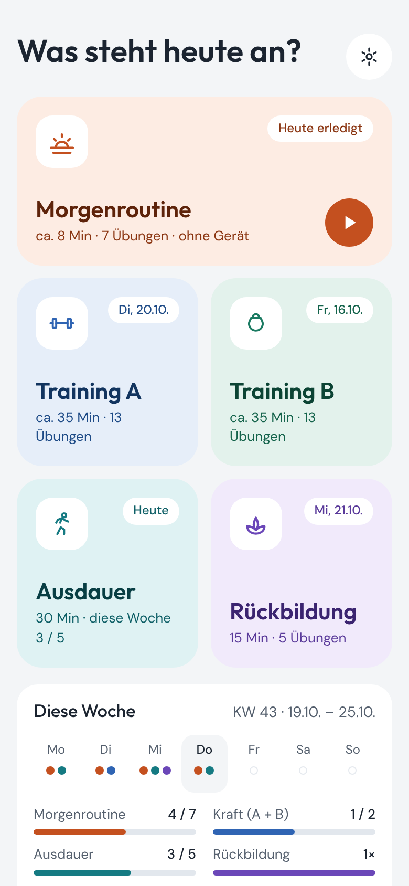
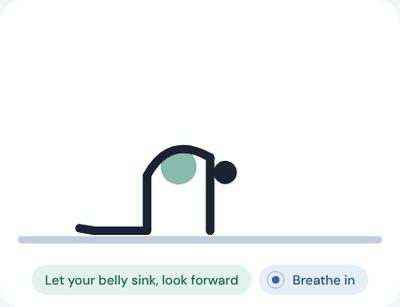
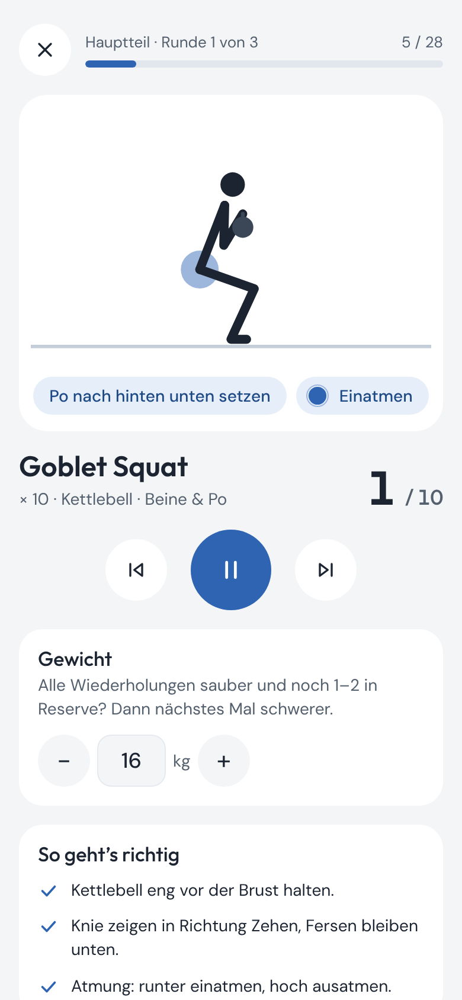

# Workout App Starter

**Bau dir deine eigene installierbare Trainings-App mit animierten Übungen. Kein Konto, kein Server, deine Daten bleiben auf deinem Handy.**

**[▶ Demo ausprobieren](https://unser-training.netlify.app/)** · [English](README.md) · [Sicherheitshinweis](DISCLAIMER.md) · [Übungsformat (englisch)](docs/exercise-format.md) · [Posen-Editor](editor.html)

  
  
  

## Warum ich das gebaut habe

Ich wollte etwas ganz Einfaches, das dem folgt, was die Forschung über gesundes Altern sagt. Die
großen Faktoren, um bis ins Alter gesund zu bleiben, sind **Stabilität, Beweglichkeit, Kraft und
Ausdauer**. Ich will nicht viermal pro Woche ins Fitnessstudio und keinen Extremsport machen. Ich
wollte eine einfache Routine, die die Grundlagen abdeckt, damit wir uns bis ins hohe Alter gut
bewegen können.

Genau das macht der Beispielplan:

- **Beweglichkeit:** eine tägliche Morgenroutine von 8 Minuten, teils noch im Bett
- **Stabilität:** Gleichgewicht und Rumpf, z. B. Bird Dog, Seitstütz und einbeiniges Kreuzheben
- **Kraft:** zwei Einheiten pro Woche à 35 Minuten mit Kettlebell und Kurzhanteln
- **Ausdauer:** 5 × 30 Minuten von allem, was dich etwas außer Atem bringt (die 150 Minuten pro Woche der WHO)

## Was drin ist

- Animiertes Strichmännchen für jede Übung, mit Phase („Über die Fersen: Hüfte hoch“) und Atemhinweis
- Wiederholungen oder Countdown, Seitenwechsel, Pausen zwischen Übungen und Runden, Piepton und Vibration, Bildschirm bleibt an
- Gewicht pro Übung mit Steigerungshinweis
- Wochenansicht: Punkte pro Tag, Wochenziele, Rückblick auf letzte Woche
- Abhak-Kacheln, z. B. für Spaziergänge (5 × 30 Min = die 150 Minuten der WHO)
- Deutsch und Englisch, hell und dunkel, funktioniert offline, lässt sich auf dem Homescreen installieren
- Ein Posen-Editor, mit dem du eigene Übungen ohne Programmieren animierst
- Einfache Dateien, kein Build-Schritt: bearbeiten, hochladen, fertig

> [!IMPORTANT]
> **Das ist ein Beispiel.** Die Einheiten in `config/` sind mein persönlicher Plan für meinen Mann und mich
> (Morgenroutine, zwei Krafteinheiten, Ausdauer und Rückbildung). Ersetze sie durch deine eigenen.
> Bitte lies den [Sicherheitshinweis](DISCLAIMER.md), besonders wenn du vor Kurzem entbunden hast.

## Schnellstart

1. **Eigene Kopie anlegen:** oben auf dieser Seite **Use this template** (oder **Fork**) klicken.
2. **Anpassen:** [`config/routines.js`](config/routines.js) direkt auf GitHub bearbeiten (Stift-Symbol). Namen, Wiederholungen, Reihenfolge. Die Übungs-IDs stehen in [`config/exercises.js`](config/exercises.js).
3. **Online stellen**, eins davon:
   - **Netlify:**  oder den Ordner auf [app.netlify.com/drop](https://app.netlify.com/drop) ziehen.
   - **GitHub Pages:** in deiner Kopie *Settings → Pages → Deploy from a branch → `main` / root*. Die App liegt dann unter `https://<du>.github.io/<repo>/`.
4. **Aufs Handy holen:** Adresse öffnen, dann
   - iPhone (Safari): Teilen → **Zum Home-Bildschirm**
   - Android (Chrome): Menü ⋮ → **App installieren** (oder *Zum Startbildschirm hinzufügen*)

Zum Ausprobieren am Computer: im Ordner `npx serve` ausführen und die angezeigte Adresse öffnen.
(Ein Doppelklick auf `index.html` reicht nicht, Browser führen JavaScript-Module nicht aus Dateien aus.)

## Was steht wo?

| Was | Wo |
|---|---|
| Einheiten, Wiederholungen, Reihenfolge, Pausen | [`config/routines.js`](config/routines.js) |
| Übungen | [`config/exercises.js`](config/exercises.js) |
| App-Name, Sprache, Farben, Wochenziele, kg-Schritte | [`config/app.config.js`](config/app.config.js) |
| Name unter dem App-Symbol | `config/app.config.js` **und** [`manifest.webmanifest`](manifest.webmanifest) |
| App-Symbole | [`icons/`](icons/) |

Mit `language: "en"` wird alles englisch, mit `"auto"` richtet sich die App nach dem Handy. Umschalten geht auch in den Einstellungen. Mit `?lang=en` am Ende der Adresse erscheint die App nur für diesen Besuch auf Englisch, ohne es zu speichern (praktisch für einen Demo-Link).

Vertippt? Die App sagt dir, wo: *Routine "strength-a": section 2, item 3: unknown exercise "goblet-sqat" (did you mean "goblet-squat"?)*.

## Eigene Übungen

1. **Nur Text (am schnellsten):** Name und Hinweise in `config/exercises.js` eintragen, ID in einer Einheit verwenden. Der Player zeigt eine Platzhalter-Figur, deine Hinweise und den Zähler. Optional `image: "bilder/uebung.gif"`.
2. **Mit dem Posen-Editor:** `editor.html` öffnen (oder Einstellungen → *Posen-Editor öffnen*), am besten am Laptop. Punkte an der Figur ziehen oder Regler nutzen, die vorherige Pose wird blass angezeigt, Ablauf zusammenstellen, **Play loop**, dann **Copy as code** und in `config/exercises.js` einfügen.
3. **Mit einer KI:** Die fertige Vorlage für ChatGPT, Claude & Co. steht im [englischen README](README.md#3-with-an-ai-assistant). Die Antwort im Editor unter *Import* einfügen und prüfen.

Wie die Figur funktioniert (Gelenke, Winkel, Posen, Ablauf): [docs/exercise-format.md](docs/exercise-format.md).

## Updates

Änderungen committen (Netlify mit GitHub oder GitHub Pages) oder den Ordner bei Netlify Drop erneut hochladen.
Beim nächsten Öffnen zeigt die App **„Update verfügbar · Tippen zum Neuladen“**. Bei größeren Änderungen zusätzlich die Version in [`version.js`](version.js) erhöhen.

## Daten und Datenschutz

- Keine Konten, keine Statistik, kein Tracking. Die App lädt nichts von fremden Servern, auch die Schriften sind dabei.
- Verlauf, Gewichte und Einstellungen liegen im Browser-Speicher dieses einen Geräts. Zwei Handys, zwei getrennte Verläufe.
- **Wer die Browserdaten löscht oder die App entfernt, löscht auch den Verlauf.** Unter *Einstellungen → Daten exportieren* ab und zu eine Sicherung speichern; mit *Daten importieren* wiederherstellen oder aufs neue Handy übertragen.

## Mitmachen

Ein privates Projekt, so wie es ist: Issues bekommen vielleicht keine Antwort, Forks sind sehr willkommen.
Neue Übungen für [`examples/library/`](examples/library/) gern als Pull Request, siehe [CONTRIBUTING.md](CONTRIBUTING.md).

Gebaut von [@intentionaleva](https://github.com/intentionaleva) mit [Claude](https://claude.ai). Code unter [MIT-Lizenz](LICENSE).
