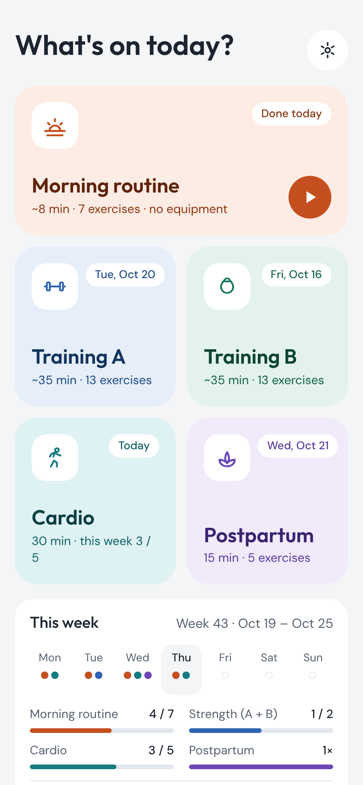
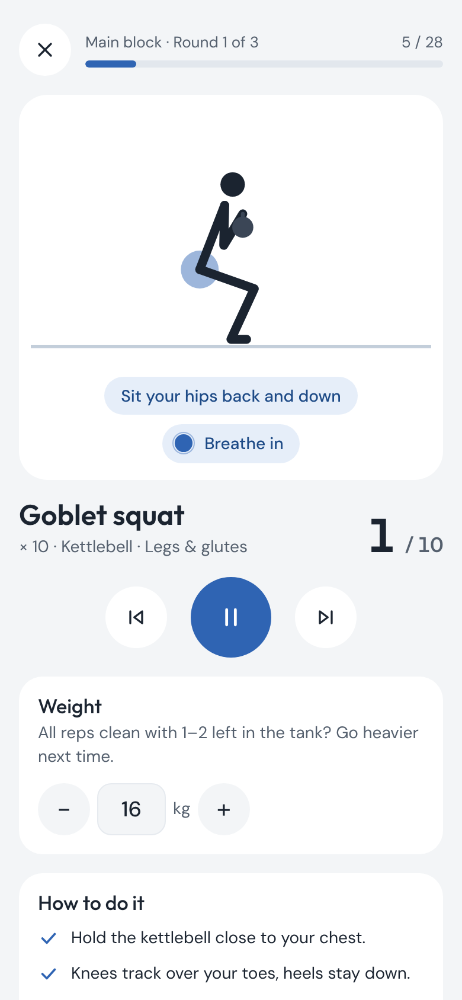
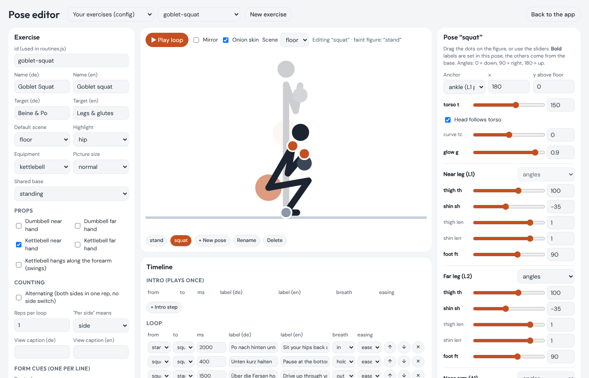

# Workout App Starter

**Build your own installable workout app with animated exercise demos. No account, no server, your data stays on your phone.**

**[▶ Try the demo](https://unser-training.netlify.app/?lang=en)** · [Deutsch](README.de.md) · [Safety note](DISCLAIMER.md) · [Exercise format](docs/exercise-format.md) · [Pose editor](editor.html)

<p>
  
  
  
</p>

- Animated stick figure for every exercise, with the current phase ("Drive through your heels, hips up") and a breathing cue
- Rep counter or countdown, left/right sides, rests between exercises and rounds, beeps and vibration, screen stays on
- Weight log per exercise with a progression hint
- Week view: dots per day, weekly goals, last week's summary
- Check-off tiles for things like walks (5 × 30 min = the WHO's 150 minutes)
- German and English, light and dark mode, works offline, installs to the home screen
- A pose editor to animate your own exercises without writing code
- Plain files, no build step: edit, upload, done

> [!IMPORTANT]
> **This is an example.** The routines in `config/` are my personal plan for my husband and me
> (a daily morning routine, two strength workouts, cardio and postpartum exercises).
> Replace them with your own. Please read the [safety note](DISCLAIMER.md), especially if you've recently given birth.

## Quick start

1. **Get your own copy.** Click **Use this template** (or **Fork**) at the top of this page.
2. **Make it yours.** Edit [`config/routines.js`](config/routines.js) right on GitHub (pencil icon). Change names, reps, order. Exercise ids come from [`config/exercises.js`](config/exercises.js).
3. **Put it online**, one of:
   - **Netlify:** [](https://app.netlify.com/start/deploy?repository=https://github.com/intentionaleva/workout-app-starter) or drag the folder onto [app.netlify.com/drop](https://app.netlify.com/drop).
   - **GitHub Pages:** in your copy, *Settings → Pages → Deploy from a branch → `main` / root*. Your app will be at `https://<you>.github.io/<repo>/`.
4. **Install it on your phone.** Open the address, then:
   - iPhone (Safari): Share button → **Add to Home Screen**
   - Android (Chrome): menu ⋮ → **Install app** (or *Add to Home screen*)

To try it on your computer first: run `npx serve` in the folder and open the address it prints.
(Double-clicking `index.html` won't work: browsers don't run JavaScript modules from files.)

## Make it yours

| What | Where |
|---|---|
| Routines, reps, order, rest times | [`config/routines.js`](config/routines.js) |
| Exercises | [`config/exercises.js`](config/exercises.js) |
| App name, language, colours, weekly goals, kg steps | [`config/app.config.js`](config/app.config.js) |
| Name under the home-screen icon | `config/app.config.js` **and** [`manifest.webmanifest`](manifest.webmanifest) (phones read the manifest when installing) |
| Icons | [`icons/`](icons/) (192 × 192, 512 × 512 and a 180 × 180 `apple-touch-icon.png`) |

Set `language: "en"` in `app.config.js` for an all-English app, or `"auto"` to follow the phone.
Everyone can still switch in the app's settings. Adding `?lang=en` to the address shows English for that visit only, without saving it (handy for sharing a demo link).

Typo somewhere? The app tells you where, e.g. *Routine "strength-a": section 2, item 3: unknown exercise "goblet-sqat" (did you mean "goblet-squat"?)*.

More examples to start from: [`examples/`](examples/) has a minimal **blank starter** and a small **exercise library**.

## Adding an exercise

### 1. Text only (fastest)

Add it to `config/exercises.js` with just a name and some tips, then use its id in a routine. The player shows a placeholder figure, your tips and the counter.

```js
"wall-sit": {
  name: { de: "Wandsitzen", en: "Wall sit" },
  cues: { de: ["Knie über den Fersen."], en: ["Knees over your heels."] },
},
```

Want a picture? Add `image: "images/wall-sit.gif"` (a file in your repo, or a link).

### 2. With the pose editor

Open **`editor.html`** in your deployed app (or Settings → *Open the pose editor*). Laptop recommended.



- Pick an exercise to start from, or **New exercise**
- Drag the dots on the figure, or use the sliders. The previous pose shows faintly behind (onion skin)
- Build the timeline: which pose to which, how long, the label and the breathing cue. Press **Play loop**
- The editor runs the same checks as CI (figure sinking into the floor, cut off, broken pose)
- **Copy as code** and paste it into `config/exercises.js`. You can also paste existing code in to edit it

### 3. With an AI assistant

Paste this into ChatGPT, Claude or similar, fill in the brackets, then paste the answer into the
pose editor (*Import*) to check and fine-tune it.

<details>
<summary>Prompt (click to open)</summary>

```text
I'm adding an exercise to my workout app. Please write the exercise object.

The app draws a 2D side-view stick figure (the person faces right).
- Positions are [x, y]: x from the left (picture is 360 wide, figure usually around x = 180),
  y = height above the floor (0 = on the floor).
- Angles are degrees: 0 = pointing down, 90 = pointing right, 180 = up, 270 = left.
- Each pose has exactly one anchor: hip: [x, y], sho: [x, y] (shoulder) or ank: [x, y]
  (near ankle on the floor; then L1 must use angles th/sh and the hip is worked out from it).
- t = torso angle from hip to shoulder (standing 180, lying on the back head-left -90).
  h = head direction (optional), tc = torso curve (+ rounds, - arches), g = glow 0..1.
- Legs L1 (near), L2 (far): { th, sh, ft } thigh, shin and foot angles.
  Arms A1 (near), A2 (far): { ua, fa } upper arm and forearm angles.
  Or IK: { to: [x, y], s: 1 or -1 } places the hand/foot and bends the elbow/knee itself.
- Segment lengths: thigh 52, shin 50, torso 62, upper arm 36, forearm 33, foot 14, neck 20.
- base is merged into every pose. Named bases: "quadruped", "supine" (on back, knees bent,
  feet planted), "standing" (ank: [180, 0], t: 180, legs straight down, arms hanging).
- loop steps: [fromPose, toPose, milliseconds, { de, en } label, breath], breath is
  "in" | "out" | "hold" | "calm". One loop = one rep.
- scene: "mat" | "floor" | "bed". highlight: "hip" | "core" | "sho".
  equipment: null | "dumbbell" | "dumbbells" | "kettlebell". props: [["db"|"kb", "h1"|"h2"]].

Example:
"glute-bridge": {
  name: { de: "Glute Bridges", en: "Glute bridges" },
  target: { de: "Po & Beinrückseite", en: "Glutes & hamstrings" },
  scene: "mat", highlight: "hip",
  base: "supine",
  poses: { down: { t: -90, g: 0.1 }, up: { t: -50, g: 0.9 } },
  loop: [
    ["down", "up", 1000, { de: "Über die Fersen: Hüfte hoch", en: "Drive through your heels, hips up" }, "out"],
    ["up", "up", 700, { de: "Oben halten", en: "Hold at the top" }, "hold"],
    ["up", "down", 1500, { de: "Langsam absenken", en: "Lower slowly" }, "in"],
  ],
  cues: { de: ["…"], en: ["…"] },
},

Please write the exercise object for: [EXERCISE NAME], [REPS OR SECONDS], [EQUIPMENT],
with 2–4 key poses, a loop with German and English phase labels, a breathing cue per step
and 3–4 form cues in German and English. Reply with only the code.
```

</details>

## How the animation works


Each exercise has a few **key poses** and a **loop** that moves between them. A pose is anchored at the
hip, shoulder or ankle; limbs are set by angles, or by putting the hand or foot at a point and letting
the elbow or knee bend (IK). The app blends between poses, adds the phase text and breathing cue, and
counts one loop as one rep. All the details: [docs/exercise-format.md](docs/exercise-format.md).

## Updating your deployed app

- **Netlify (linked to GitHub) or GitHub Pages:** commit your change, it goes live in a minute or two.
- **Netlify Drop:** drag the folder onto your site's *Deploys* page again.

Phones pick up changes the next time the app is opened and show **"Update available · Tap to reload"**.
For bigger changes, also bump the version in [`version.js`](version.js) so every file is fetched fresh.

## Your data and privacy

- No accounts, no analytics, no tracking. The app makes no requests to anyone but your own site (fonts are included).
- The workout log, weights and settings live in your browser's storage on that one device. Two phones means two separate logs.
- **Clearing your browser data (or uninstalling the app) deletes the log.** Use *Settings → Export data* now and then to save a backup file, and *Import data* to restore it or move it to a new phone.
- *Settings → Delete all data* wipes everything from the device.

## For developers

```sh
npm install          # Playwright for the browser tests
npm start            # serve on http://localhost:3000
npm run check        # animation checks + config validation (no browser needed)
npm run smoke        # headless browser: every routine start to finish, no console errors, offline
npm run screenshots  # regenerate docs/screenshots (needs ffmpeg for the GIF)
```

No build step and no runtime dependencies: plain ES modules. The offline cache is off on `localhost`
so edits show up on reload; add `?sw` to the address to test it. Layout:

```
index.html, styles.css      app shell
src/rig.js                  skeleton, IK, pose solver, SVG drawing
src/exercise.js             turns config data into animations, validation
src/player.js               timing, reps, sides, rests, breathing, beeps, wake lock
src/screens.js              home, overview, player, check-off, settings
src/storage.js              localStorage log, weights, export/import
src/i18n.js                 UI text (de, en)
src/editor.js, editor.html  pose editor
config/                     your plan
examples/                   example plans and the exercise library
tools/                      checks, smoke test, screenshot and diagram scripts
sw.js, version.js           offline support and updates
```

Every push runs the checks and the smoke test on GitHub Actions ([`.github/workflows/check.yml`](.github/workflows/check.yml)).

Coming from the original single-file version? Your saved log and weights are moved over automatically on first launch.

## Contributing

This is a personal project shared as-is: issues may not get answers, but forks are very welcome.
New exercises for [`examples/library/`](examples/library/) are welcome as pull requests. See [CONTRIBUTING.md](CONTRIBUTING.md).

## Credits

Built by [@intentionaleva](https://github.com/intentionaleva) with [Claude](https://claude.ai).
Fonts: [Outfit](https://github.com/Outfitio/Outfit-Fonts) and [DM Sans](https://github.com/googlefonts/dm-fonts), SIL Open Font License ([`fonts/`](fonts/)).
Code: [MIT](LICENSE).
