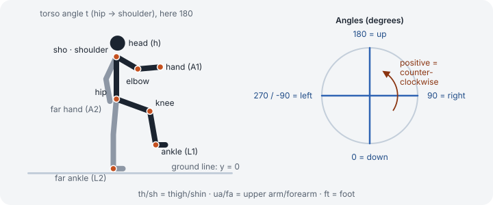

# Exercise and routine format

Everything you'd want to change lives in three files in `config/`. They're plain JavaScript
objects, so you can edit them in any text editor, including GitHub's web editor.

- [`config/app.config.js`](../config/app.config.js): app name, language, colours, rest times, weekly goals
- [`config/exercises.js`](../config/exercises.js): the exercise library
- [`config/routines.js`](../config/routines.js): which exercises, in what order, how many reps

If something is wrong, the app shows a message like
`Exercise "glute-bridge": loop step 2 references unknown pose "top" (did you mean "up"?)`
instead of a blank page. `npm run check` shows the same messages in the terminal.

## Text

Any text can be a plain string (same for every language) or one string per language:

```js
name: "Bird dog"
name: { de: "Vogel-Hund", en: "Bird dog" }
```

Lists of tips (`cues`) work either way too: `["…", "…"]` or `{ de: ["…"], en: ["…"] }`.

## An exercise

```js
"glute-bridge": {
  name: { de: "Glute Bridges", en: "Glute bridges" },
  target: { de: "Po & Beinrückseite", en: "Glutes & hamstrings" },
  scene: "bed",                  // bed | mat | floor
  highlight: "hip",              // glowing circle: hip | core | sho
  equipment: null,               // null | "dumbbell" | "dumbbells" | "kettlebell" | any text
  props: [],                     // [["db" | "kb", "h1" | "h2"]], e.g. [["kb", "h1"]]
  alternating: false,            // true: left and right happen inside one rep (bird dog)
  sideWord: "side",              // "side" | "direction" (for "× 8 per side / each direction")
  base: "supine",                // merged into every pose (see below)
  poses: {
    down: { t: -90, g: .1 },
    up:   { t: -50, g: .9 },
  },
  intro: [],                     // steps that play once at the start
  loop: [
    ["down", "up",   1000, { de: "Über die Fersen: Hüfte hoch", en: "Drive through your heels, hips up" }, "out"],
    ["up",   "up",    700, { de: "Oben halten", en: "Hold at the top" }, "hold"],
    ["up",   "down", 1500, { de: "Langsam absenken", en: "Lower slowly" }, "in"],
    ["down", "down",  300, { de: "Kurz ablegen", en: "Rest briefly" }, "in"],
  ],
  cues: { de: ["…"], en: ["…"] },
  repsPerLoop: 1,                // dead bug: 2 (one loop = both sides)
},
```

All fields except `name` are optional.

| Field | Meaning |
|---|---|
| `scene` | Background: `bed` (bed with pillow), `mat` (exercise mat), `floor` (thin line). Default `mat`. A routine can show an exercise in a different scene. |
| `highlight` | Where the glowing circle sits: `hip`, `core` (middle of the torso), `sho` (shoulder). |
| `equipment` | Shows a chip and the weight log. `dumbbell`, `dumbbells` and `kettlebell` are translated; anything else is shown as written. The +/− step comes from `weightStep` in `app.config.js`. |
| `props` | Draws a dumbbell (`db`) or kettlebell (`kb`) in the near (`h1`) or far (`h2`) hand. Add `"arm"` as a third value to let a kettlebell hang along the forearm (swings). |
| `view` | Small caption on the picture, e.g. `{ de: "Ansicht von vorn", en: "Front view" }`. |
| `frame` | `"tall"` zooms out so arms above the head fit (shoulder press). |
| `extends` | Id of another exercise to copy everything from. Your own fields win; poses with the same name are merged. If you set `loop`, the parent's `intro` is dropped unless you set your own. |
| `image` | Text-only exercises: a picture or GIF (URL or a file in your repo) shown instead of the placeholder. |
| `repSeconds` | Text-only exercises: how fast the rep counter counts (default 3 s, see `defaults` in `app.config.js`). |

### Text-only exercises

Leave out `poses` and `loop` and you have a text-only exercise. The player shows a neutral
placeholder (or your `image`), the tips and the counter. This is the quickest way to get your
plan into the app: animate the exercises later, or never.

```js
"jumping-jacks": {
  name: "Jumping jacks",
  cues: ["Land softly.", "Arms overhead, feet apart, then back."],
  repSeconds: 1,
},
```

## Poses



The figure is a 2D side view: hip, torso, head, two legs (thigh, shin, foot), two arms (upper arm,
forearm). The near side (`L1`, `A1`) is drawn dark, the far side (`L2`, `A2`) light grey behind.

**Positions** are `[x, y]`: `x` from the left edge (the picture is 360 wide, the figure usually
stands around 180) and `y` = **height above the floor**. `y: 0` means on the floor. That's why the
same exercise works on the mat and in bed: the app moves everything to the scene's floor.

**Angles** are in degrees: `0` points straight down, `90` right, `180` up, `270` (or `-90`) left.

| Key | Meaning |
|---|---|
| `hip: [x, y]` | Anchor the figure at the hip. |
| `sho: [x, y]` | Anchor at the shoulder (hip is placed along the torso). Handy for lying on the back. |
| `ank: [x, y]` | Anchor at the near ankle, for standing exercises: knee and hip are worked out upwards from `L1`, so `L1` must use angles. |
| `t` | Torso angle, from hip to shoulder. Standing = `180`, lying on the back with head left = `-90`. |
| `h` | Head direction. Leave out to follow the torso. |
| `tc` | Bend the torso: positive rounds the back (cat), negative arches it (cow). |
| `g` | Glow strength of the highlight, `0` to `1`. |
| `L1`, `L2` | Legs: `{ th, sh, ft }` = thigh, shin and foot angles. Optional `tl`, `sl` shorten thigh or shin (0–1), useful for front views. |
| `A1`, `A2` | Arms: `{ ua, fa }` = upper arm and forearm angles. |
| `{ to: [x, y], s: 1 }` | Instead of angles, put the foot or hand at a point and let the knee/elbow bend by itself. `s` (`1` or `-1`) picks which way it bends. Legs can add `ft`. |

Leave out a limb to hide it.

### Shared bases

`base` is merged into every pose, so each pose only lists what changes:

```js
base: "quadruped",                          // a named base
base: { hip: [130, 52], t: 106 },           // your own
base: ["supine", { A1: up, A2: up }],       // a named base plus changes
```

Named bases: `quadruped` (on hands and knees), `supine` (on the back, knees bent, feet planted),
`standing` (standing, ankle-anchored). They're defined in [`src/rig.js`](../src/rig.js).

Merging rules: a limb in a pose changes only the keys it lists (`L1: { ft: 120 }` just turns the
foot). Switching a limb between angles and `to` replaces it. Setting a different anchor replaces
the base's anchor.

### The loop

Each step is `[from, to, milliseconds, label, breath, easing]`:

- `from`, `to`: pose names. `["up", "up", 700, …]` holds still.
- `label`: the phase text under the figure.
- `breath`: `in`, `out`, `hold` (hold tension) or `calm`. The blue dot grows or shrinks with it.
- `easing` (optional): `"linear"` for walking-style steady movement; default is smooth in and out.

One loop is one rep (or `repsPerLoop` reps). For timed exercises the loop just repeats.

## Routines

```js
{
  id: "morning",                       // short, unique, no spaces. Don't rename later: the log uses it
  name: { de: "Morgenroutine", en: "Morning routine" },
  tone: "orange",                      // a colour from app.config.js → tones
  icon: "sunrise",                     // sunrise dumbbell kettlebell run lotus heart moon flame bike stretch star
  featured: true,                      // gets the wide tile (default: the first routine)
  frequency: "daily",                  // shows "Daily" and "Start routine"
  duration: { de: "ca. 8 Min", en: "~8 min" },
  gear: "No equipment",                // chip on the overview
  tileNote: "no equipment",            // extra text on the tile
  rest: 5, roundRest: 5,               // seconds between exercises / rounds
  goal: { group: "morning", perWeek: 7 },
  sections: [
    {
      title: { de: "Im Bett", en: "In bed" },
      badge: "No equipment",           // optional; default "3 rounds" when rounds > 1
      rounds: 1,
      items: [
        { ex: "glute-bridge", reps: 30, scene: "bed" },
        { ex: "knee-wipers", reps: 10, perSide: true },
        { ex: "bird-dog-reach", secs: 60 },
        { ex: "yogi-squat", secs: 30, label: { de: "30 s halten", en: "Hold 30 s" } },
      ],
    },
  ],
}
```

- `reps` or `secs`: one of them per item.
- `perSide: true`: after the first side the player pauses 4 s (`defaults.sideSwitch`), mirrors the
  figure and runs the second side. Exercises with `alternating: true` do both sides inside each rep instead.
- Sections you use twice can be a `const` at the top of the file (see `warmup` in `config/routines.js`).

### Weekly goals

`goal.group` lets several routines count towards one bar: Training A and B both use
`group: "strength"`, so the week view shows "Strength (A + B) 1 / 2". Labels for shared groups
go in `goals` in `app.config.js`. `perWeek: 0` means "just count".

### Check-off routines

For things you don't need guidance for (walks, bike rides), a tile you tap to log:

```js
{
  id: "cardio", type: "checkoff",
  name: { de: "Ausdauer", en: "Cardio" },
  tone: "cyan", icon: "run",
  minutes: 30,
  goal: { group: "cardio", perWeek: 5 },
  kinds: [
    { id: "walk", name: { de: "Gehen", en: "Walking" } },
    { id: "bike", name: { de: "Rad", en: "Cycling" } },
  ],
}
```
